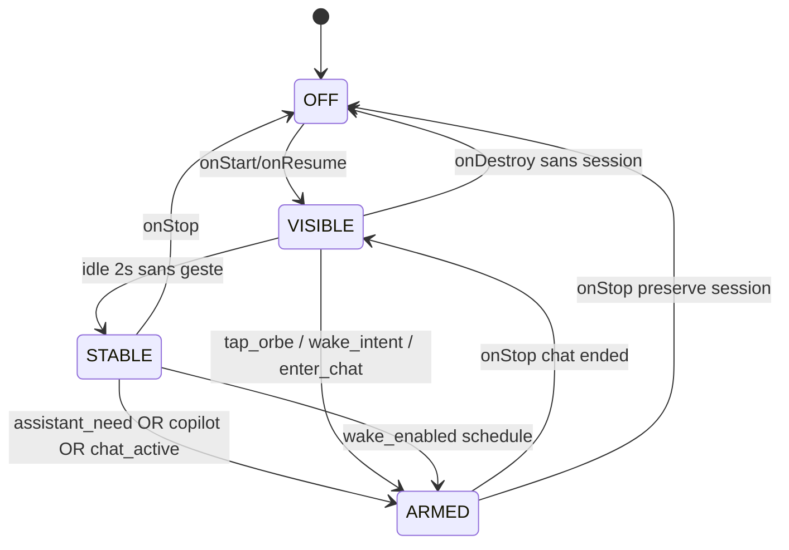

# Spec — HOME lazy bootstrap (Orbe launcher)

> Objectif : HOME = shell visuel léger. Assistant / prefetch / natives lourdes = **à la demande** ou **après stabilité**, pas à chaque `onResume`.

**Version** : 1.0 — 2026-08-13  
**Périmètre** : process principal, `MainActivity`, `LifecycleBridge`, satellites visuels / voix / prefetch.  
**Hors scope phase 1–2** : split process `:assistant`, deux APK, refactor `PegaseSession` multi-process.

---

## 1. Problème & objectifs

### Symptômes
- Lag perceptible au retour HOME (frame drops, hitch micro).
- Apps arrière-plan tuées après passage sur le bureau (pic RAM + `largeHeap`).

### Causes identifiées
| Source | Type | Moment |
|--------|------|--------|
| Fluid animé full-screen | GPU continu | `onStart` frame+1 |
| Decode wallpaper + sync lock Fluid | CPU/RAM/GPU | `onResume` frame+1, +420 ms |
| Prefetch (`PrefetchService.run`) | CPU/RAM/réseau | +420 ms chaque HOME* |
| Wake STT (`VoiceWakeClient.startListening`) | CPU/main thread | +1600 ms |
| `AppListCache.warmUp` | CPU/PM scan | `onCreate` |
| `DigitalInkManager.getInstance()` | ML Kit init/download | `onCreate` |
| `PegaseSession.get()` → `ToolRegistry` (~50 tools) | RAM/CPU | `onCreate` |
| `wireVoiceAndLifecycle()` complet | RAM | `onCreate` |
| `VoiceWakeClient.sync()` | bind `:voice` | `onCreate` |

\* Prefetch ne fait le gros travail que le **1er lancement du jour**, mais `run()` est quand même appelé.

### Objectifs mesurables
| Métrique | Avant (estim.) | Cible phase 1 | Cible phase 3 |
|----------|----------------|-----------------|---------------|
| Travail planifié T+0..500 ms au retour HOME | 6–8 tâches | ≤ 2 | ≤ 1 |
| Pic RAM au retour HOME (sans chat actif) | élevé | −30 % | −50 % |
| GPU idle sur HOME (utilisateur statique) | Fluid 60 fps | 0 fps (statique) | 0 fps ou opt-in |
| Cold open tiroir apps | instant (warmUp) | +100–300 ms 1× | +100 ms 1× |
| 1er tap orbe → écoute | instant | ≤ 500 ms acceptable | ≤ 400 ms |

---

## 2. Principe directeur

### Trois tiers de chargement

```
T0 — HOME_SHELL     → afficher orbe + fond statique (immédiat)
T1 — HOME_INTERACT  → gesture utilisateur (tiroir, encre, raccourci)
T2 — ASSISTANT      → voix, session, LLM, wake, prefetch lourd
```

### Règle d'or
> **Aucune tâche T2 au simple retour HOME** sauf si un état global exige la continuité (chat actif, copilote AlwaysOn, wake in-place).

### Feature flag central
`HomeLoadPolicy` lit `SharedPreferences` + états runtime :

| Clé prefs | Défaut phase 1 | Description |
|-----------|----------------|-------------|
| `home_lazy_bootstrap` | `true` | Master switch (rollback facile) |
| `fluid_animated` | `false` après migration | Fluid drift ON/OFF |
| `prefetch_on_home_resume` | `false` | Prefetch au resume HOME |
| `wake_on_home_stable_only` | `true` | Wake seulement après HOME_STABLE |

---

## 3. Machine d'états — `HomeBootstrapCoordinator`

Nouvelle classe :  
`app/src/main/java/com/pegasuscorp/orbe/session/HomeBootstrapCoordinator.java`

### États



| État | Signification | Tâches autorisées |
|------|---------------|-------------------|
| `OFF` | Activity absente | LLM idle unload OK |
| `VISIBLE` | HOME à l'écran, pas stable | OrbView ambient, fond statique, charging monitor |
| `STABLE` | 2 s sans encre/tiroir/transition | Wake (si ON), hints, prefetch idle* |
| `ARMED` | Assistant requis maintenant | Session init, STT, VoiceWake bind, resume chat |

\* Prefetch : uniquement si 1er lancement du jour **et** pas low-mem **et** pas de chat.

### Timers (remplace / encapsule constantes `LifecycleBridge`)

| Constante | Valeur | Remplace |
|-----------|--------|----------|
| `HOME_STABLE_MS` | 2000 | partie de WAKE + GESTURE |
| `HOME_WARMUP_DELAY_MS` | 420 | conservé pour hints légers |
| `HOME_WAKE_DELAY_MS` | 1600 | appliqué seulement depuis STABLE |
| `HOME_GESTURE_IDLE_MS` | 2400 | inchangé |
| `FLUID_ANIM_DELAY_MS` | 2500 | nouveau — après STABLE + opt-in |
| `PREFETCH_IDLE_DELAY_MS` | 5000 | nouveau — depuis STABLE |

### API publique (draft)

```java
public final class HomeBootstrapCoordinator {
    public enum Phase { OFF, VISIBLE, STABLE, ARMED }

    public interface Host extends LifecycleBridge.Host {
        MainActivity mainActivity();
        boolean isLazyBootstrapEnabled();
        void ensureAssistantWired();      // wireVoice si pas fait
        void ensureInkManager();          // lazy ML Kit
    }

    public static HomeBootstrapCoordinator get(MainActivity activity);

    public Phase phase();
    public void onStart();
    public void onResume();
    public void onPause();
    public void onStop();
    public void onTrimMemory(int level);
    public void onDestroy();

    /** Geste HOME — reset timer stable + reporte T2 */
    public void noteHomeInteraction();

    /** Entrée assistant explicite — force ARMED + ensureAssistantWired */
    public void requestAssistant(AssistantReason reason);

    public enum AssistantReason {
        ORB_TAP, ORB_LONG_PRESS, WAKE_INTENT, TEXT_DISCUSSION,
        CHAT_ACTIVE_RESUME, COPILOT_ALWAYS_ON, VOICE_IN_PLACE
    }
}
```

`LifecycleBridge` devient un **adaptateur mince** qui délègue au coordinator (évite gros diff d'un coup).

---

## 4. Inventaire actuel → action cible

### 4.1 `MainActivity.onCreate` (lignes ~105–234)

| Ligne / appel | Tier actuel | Tier cible | Action |
|---------------|-------------|------------|--------|
| `Trace.init` | T0 | T0 | Garder |
| `PrefetchScheduler.ensureScheduled` | boot | boot | Garder (alarme only, pas run) |
| `IntentionScheduler`, F1 schedulers | boot | boot | Garder (WorkManager/Alarm, pas exécution immédiate) |
| `PermissionFlow.ensureLocation` | T0 | T1 | Reporter au 1er besoin location (intentions) — **phase 2** |
| `AppListCache.warmUp` | T0 | T1 | **Supprimer** ; tiroir appelle déjà `loadAsync` |
| `DigitalInkManager.getInstance()` | T0 | T1 | **`ensureInkManager()`** au 1er stroke |
| `attachInkStatusListener` | T0 | T1 | Avec ensureInk |
| `PegaseSession.get + init` | T0 | T2 | Déplacer vers `requestAssistant()` |
| `wireVoiceAndLifecycle()` | T0 | T2 | Idem — ou split « shell » vs « assistant » |
| `VoiceWakeClient.sync` | T0 | T2/STABLE | Coordinator STABLE seulement |
| `ChatVoiceBridge.register` | resume | T2/ARMED | Si chat actif ou ARMED |
| `maybeOfferPiperDownload` | T0 | T2 | Au 1er usage TTS local — **phase 2** |

### 4.2 `LifecycleBridge.onResume`

| Appel | Tier cible | Condition |
|-------|------------|-----------|
| `PegaseSession.init(VOICE)` | T2 | `ARMED` ou chat/interface active |
| `ChatVoiceBridge.register` | T2 | idem |
| `reloadWallpaperIfNeeded` | T1 | Si custom wallpaper visible |
| `refreshFluidPhaseOnResume` | T0/T1 | Phase statique seulement ; anim si opt-in + STABLE |
| `PrefetchService.run` | T2 idle | STABLE + 1×/jour + flag |
| `syncFluidLockWallpaperIfDue` | T1 | STABLE + option ON + pas low-mem |
| `VoiceWakeClient.startListening` | T2 | STABLE + wake ON + shouldListen |
| `resumeChatListeningIfNeeded` | T2 | **Immédiat** si chat actif → force ARMED |

### 4.3 Visuels — Fluid

| Mode | Comportement |
|------|--------------|
| **Défaut post-migration** | Fond = `FluidRenderer.renderBitmap` une fois (phase jour), **pas** de `ValueAnimator` |
| **Opt-in** (`fluid_animated=true`) | Drift après `FLUID_ANIM_DELAY_MS` en STABLE |
| **Wallpaper custom visible** | `fluidBackground.stop()` + GONE — **ne pas animer sous opaque** |
| **low-mem** | Statique only |

Fichiers : `OrbUiController`, `FluidBackgroundView`, `PersonalizationStore`, `PersonalizationPanel` (libellé).

### 4.4 Déjà lazy (ne pas casser)

| Composant | Trigger actuel | Garder |
|-----------|----------------|--------|
| `LlmEngineManager.loadActiveModel` | `enterChatMode`, `ensureHeavyNativesReady` | Oui |
| `PrefetchScheduler` alarm | matin 6h40 | Oui — **seule voie prefetch** en phase 1 |
| `VoiceWakeClient` bind | 1er `startListening` | Oui |
| `AppListCache.loadAsync` | tiroir si cache vide | Oui |
| LLM unload idle | `onStop` + 3 min | Oui |

---

## 5. Plan d'implémentation par phases

### Phase 1 — Quick wins (PR #1, ~2–3 j) ✅ implémenté 2026-08-13

**Objectif** : gain immédiat, risque minimal, pas de changement voix/session.

| # | Tâche | Fichiers | Détail |
|---|-------|----------|--------|
| 1.1 | Retirer `AppListCache.warmUp` de MainActivity | `MainActivity.java`, `HomeAssetController.java` | Vérifier tiroir : déjà `loadAsync` L438–440 |
| 1.2 | ML Kit lazy | `DigitalInkManager.java`, `MainActivity.java` | Constructeur privé sans init ; `ensureLoaded(ctx)` idempotent ; `getInstance()` sans side-effect |
| 1.3 | Prefetch hors HOME resume | `LifecycleBridge.java` | Retirer `PrefetchService.run` de `runDeferredHomeWarmup` ; commentaire → alarme matinale only |
| 1.4 | Fluid statique par défaut | `PersonalizationStore.java`, `OrbUiController.java`, `FluidBackgroundView.java` | Nouvelle clé `fluid_animated` default false ; `applyFluidBackground` pose bitmap statique ; start drift si opt-in |
| 1.5 | Stop Fluid sous wallpaper | `OrbUiController.applyPersonalization` | Si `homeWallpaper VISIBLE` → stop + hide fluid |
| 1.6 | Flag rollback | `HomeLoadPolicy.java` (nouveau, minimal) | `isLazyBootstrapEnabled()` default true |

**Tests manuels phase 1**
- [ ] Cold start HOME → pas de toast ML Kit « Chargement… »
- [ ] 1er swipe tiroir → apps apparaissent (< 500 ms acceptable)
- [ ] 1er trait encre → modèle charge puis reconnaissance OK
- [ ] Retour HOME ×10 sans chat → pas de prefetch log réseau
- [ ] Fluid statique visible, pas de drift sauf opt-in
- [ ] Wallpaper custom → pas de Fluid animé dessous

---

### Phase 2 — Coordinator + HOME stable (PR #2, ~3–5 j) ✅ implémenté 2026-08-13

**Objectif** : machine d'états, wake différé propre, lifecycle clarifié.

| # | Tâche | Fichiers |
|---|-------|----------|
| 2.1 | Créer `HomeBootstrapCoordinator` | nouveau |
| 2.2 | Créer `HomeLoadPolicy` | nouveau |
| 2.3 | Migrer timers de `LifecycleBridge` → coordinator | `LifecycleBridge.java` |
| 2.4 | `onResume` : session/register seulement si ARMED ou chat | coordinator + bridge |
| 2.5 | Wake : STABLE + `wake_on_home_stable_only` | coordinator |
| 2.6 | Fluid anim : STABLE + opt-in | coordinator |
| 2.7 | `noteHomeInteraction` → reset STABLE timer | déjà partiel, centraliser |
| 2.8 | Logging diag | `Trace` events `home_phase` |

**États qui forcent ARMED immédiatement** (bypass STABLE)
- `ChatSessionRegistry.isActive()`
- `PegaseWakeController.isVoiceChatActive()`
- `PegaseWakeController.isInPlaceVoiceActive()`
- `CopilotPrefs.isAlwaysOn()` + overlay
- Intent `wake_activate` / `resume_chat`
- `PegaseInterfaceState.isOpen()`

**Tests manuels phase 2**
- [ ] HOME idle 2 s → wake démarre (si ON)
- [ ] HOME + swipe tiroir → wake repoussé
- [ ] Chat actif → open Chrome → overlay → retour HOME : STT continue, ARMED
- [ ] Copilote AlwaysOn : overlay OK, pas de régression
- [ ] Wake intent au cold start : ARMED immédiat

---

### Phase 3 — Assistant lazy (PR #3) ✅ implémenté

**Objectif** : `MainActivity.onCreate` ne wire plus l'assistant tant qu'aucune action.

| # | Tâche | Fichiers | Statut |
|---|-------|----------|--------|
| 3.1 | Extraire `AssistantBootstrap` | `AssistantBootstrap.java` | ✅ |
| 3.2 | `ensureAssistantWired()` : session, voice handlers, bridge | `MainActivity.java`, `LifecycleBridge.Host` | ✅ |
| 3.3 | Orb long-press / tap → `requestAssistant(ORB_*)` | `MainActivity.wireOrbGestures` | ✅ |
| 3.4 | `onNewIntent` wake → ARMED avant wire | `MainActivity`, `LifecycleBridge` | ✅ |
| 3.5 | ToolRegistry lazy par canal | `PegaseSession`, `ToolRegistry` | ⏭ optionnel |
| 3.6 | UI « Pégase se réveille… » | `OrbView.setThinking` (~420 ms) | ✅ |
| 3.7 | `VoiceWakeClient.sync` seulement ARMED/STABLE | coordinator + `finishAssistantColdStart` | ✅ |

**Contrat `ensureAssistantWired()`**
```java
// Idempotent, thread-safe, main thread only
void ensureAssistantWired() {
    if (assistantWired) return;
    pegaseSession = PegaseSession.get(this);
    pegaseSession.init(new SessionContext(Channel.VOICE, true));
    wireVoiceAndLifecycle(); // ou équivalent déjà partiel
    ChatVoiceBridge.register(this);
    assistantWired = true;
}
```

**Tests manuels phase 3** (critiques)
- [ ] Cold HOME → tap orbe long → chat vocal complet
- [ ] Discussion texte (triple tap / phase click)
- [ ] Bureau, Orion, copilote
- [ ] MainActivity tuée OEM mid-chat + overlay
- [ ] Mic permission flow après lazy wire
- [ ] `onDestroy` preserve session (wake in-place)

---

### Phase 4 — Polish (PR #4) ✅ implémenté

| # | Tâche | Fichiers | Statut |
|---|-------|----------|--------|
| 4.1 | Piper offer au 1er TTS (pas au wire) | `PiperOfferBridge`, `SpeechOutput`, `HomeAssetController` | ✅ |
| 4.2 | GPS lazy — pas de dialog au boot | `LocationLazyGate`, `MainActivity`, `IntentionScheduler` | ✅ |
| 4.3 | Prefetch idle JobScheduler (charge + idle) | `PrefetchIdleJobService`, `PrefetchIdleScheduler` | ✅ |

**Rollback PR4** : `HomeLoadPolicy.setLazyBootstrapEnabled(ctx, false)` désactive aussi idle prefetch + defer location.

---

## 6. Matrice triggers → ensure*

| Trigger | ensureAssistant | ensureInk | warmApps | prefetch | wake | fluid anim |
|---------|-----------------|-----------|----------|----------|------|------------|
| onCreate HOME | — | — | — | — | — | statique |
| onResume HOME calme | — | — | — | — | STABLE | STABLE |
| Swipe tiroir | — | — | loadAsync | — | defer | — |
| Trait encre | — | ✓ | — | — | defer | — |
| Long press orbe | ✓ | — | — | — | ARMED | — |
| Chat actif resume | ✓ | — | — | — | ✓ | — |
| Wake word intent | ✓ | — | — | — | ✓ | — |
| Copilote AlwaysOn | ✓* | — | — | — | pause | — |
| Alarm prefetch 6h40 | — | — | — | ✓ | — | — |

\* Copilote : session via `CopilotController` — vérifier si `PegaseSession.get` déjà appelé ailleurs ; ne pas double-init.

---

## 7. Cas limites (checklist régression)

### Voix / session
1. **open_app pendant chat** : MainActivity destroyed, overlay STT continue.
2. **Interface texte ouverte** : HOME pause ne finalize pas session.
3. **Bureau actif** : wake stoppé, pas de re-listen HOME.
4. **Micro mute** : ensureMic false, pas de crash si assistant lazy.
5. **Permission mic** deferred : `pendingEnterChatAfterMic` après ensureAssistantWired.

### Mémoire
6. **onTrimMemory UI_HIDDEN** : stop fluid anim, pause orb ; **ne pas** release wallpaper (déjà codé).
7. **onTrimMemory COMPLETE** : release wallpaper ; prochain HOME statique OK.
8. **low-mem** : skip prefetch, skip fluid anim, wake = sync léger only.

### Visuel
9. **Rotation / multi-window** : coordinator reset STABLE timer.
10. **Personnalisation toggle Fluid** : apply immédiat sans restart.

---

## 8. Ordre des PR (pour l'agent implémenteur)

```
PR1  home-lazy-phase1-quick-wins
  ├─ HomeLoadPolicy (minimal)
  ├─ AppListCache warmUp removal
  ├─ DigitalInkManager lazy
  ├─ Prefetch off home resume
  └─ Fluid static default + stop under wallpaper

PR2  home-bootstrap-coordinator
  ├─ HomeBootstrapCoordinator
  ├─ LifecycleBridge delegates
  ├─ Wake on STABLE only
  └─ Trace home_phase logs

PR3  assistant-lazy-wire
  ├─ ensureAssistantWired
  ├─ MainActivity onCreate slim
  ├─ Orb gestures → requestAssistant
  └─ ToolRegistry lazy (optional sub-PR)

PR4  polish (optionnel) ✅ implémenté
  ├─ Piper download lazy (1er TTS)
  ├─ Location permission lazy
  └─ Prefetch idle job (JobScheduler) vs alarm only
```

Chaque PR : `assembleDebug` + tests manuels section correspondante.

---

## 9. Fichiers touchés (résumé)

| Fichier | Phase |
|---------|-------|
| `AssistantBootstrap.java` | 3 **nouveau** |
| `MainActivity.java` | 1, 3 |
| `LifecycleBridge.java` | 1, 2 |
| `HomeBootstrapCoordinator.java` | 2 **nouveau** |
| `HomeLoadPolicy.java` | 1 **nouveau** |
| `DigitalInkManager.java` | 1 |
| `OrbUiController.java` | 1, 2 |
| `FluidBackgroundView.java` | 1 |
| `PersonalizationStore.java` | 1 |
| `PersonalizationPanel.java` | 1 |
| `AppListCache.java` | — (déjà async) |
| `HomeAssetController.java` | 1 |
| `AssistantBootstrap.java` | 3 **nouveau** (optionnel) |
| `PegaseSession.java` / `ToolRegistry.java` | 3 optionnel |

---

## 10. Rollback

1. `HomeLoadPolicy.setLazyBootstrapEnabled(false)` → comportement legacy approximatif.
2. Revert PR1 seul si régression encre/tiroir.
3. Coordinator behind flag : si `!isLazyBootstrapEnabled()`, `LifecycleBridge` exécute l'ancien chemin (garder branche legacy 1 release).

---

## 11. Notes implémenteur (agent)

- **Ne pas** lazy `ChatVoiceBridge.getSharedVoice` si chat déjà actif au resume — toujours checker flags avant skip.
- **`AppDrawerPanel`** charge déjà async : warmUp était une optimisation preemptive, safe to remove.
- **`PrefetchService.run`** via alarm matinale (`PrefetchAlarmReceiver`) reste la source principale ; vérifier pas de double run même jour.
- **Tests unitaires** possibles : `HomeBootstrapCoordinator` transitions avec handler fake ; `DigitalInkManager.ensureLoaded` idempotent.
- **Pas de doc utilisateur** requis ; option personnalisation « Fluid animé » suffit.

---

## 12. Critères de done global

- [x] PR1 — quick wins (2026-08-13)
- [x] PR2 — HomeBootstrapCoordinator (2026-08-13)
- [ ] Retour HOME sans chat : ≤ 2 tâches lourdes planifiées avant 2 s idle
- [ ] Fluid ne tourne pas sous wallpaper opaque
- [ ] ML Kit ne se charge pas au boot
- [ ] Prefetch pas déclenché par simple HOME resume
- [ ] Tous chemins voix (chat, wake, in-place, overlay) validés manuellement
- [ ] Flag rollback testé
